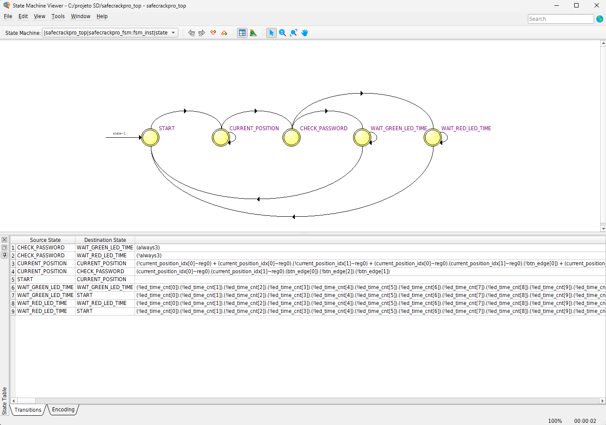

# Projeto_SD__cofre_DE2-115


## Diagrama de Estados


## Waveform Simulação


## Principais Bugs e Limitações
**Ausência de filtro de debounce mecânico nos botões (KEY[3:1]):** O código implementa um detector de borda síncrono (btn_pos & ~btn_prev) amostrado a 50 MHz (a cada 20 ns), mas não aplica um temporizador de filtragem (tipicamente 10 ms a 20 ms). Na simulação o sinal é ideal, mas na placa física o repique mecânico (bouncing) do botão pode fazer um único clique ser interpretado como dois ou mais pulsos seguidos, pulando números ou posições.

**Senha fixa no código-fonte (1-2-3-4):** Por compatibilidade com o testbench de validação, a senha está gravada como parâmetros fixos (localparam) no hardware, não permitindo que o usuário redefina uma nova senha diretamente pelos botões da placa.

**Tentativas ilimitadas sem bloqueio (lockout):** O sistema não contabiliza falhas consecutivas; após errar a senha e aguardar os 3 segundos de sinalização nos LEDs vermelhos, o usuário pode tentar novamente sem restrição.

**Bloqueio de entradas durante os temporizadores de feedback:** Durante os estados WAIT_GREEN_LED_TIME (5 s) e WAIT_RED_LED_TIME (3 s), os botões de edição e confirmação ficam inativos, sendo possível interromper a contagem apenas pelo reset global (KEY[0]).

## Descrição detalhada de como os requisitos foram implementados
### Visão geral

O projeto é uma FSM com cinco estados, um detector de borda para os botões e um contador regressivo para os tempos dos LEDs. O módulo `safecrackpro_fsm` recebe `KEY[3:1]` em `btn[2:0]` e o reset em `rstn` (ligado a `KEY[0]`). Suas saídas são os quatro dígitos (`digits`), o índice do dígito ativo (`current_position_idx`) e os LEDs verdes e vermelhos. A conversão para 7 segmentos fica no top-level.

| Requisito | Onde é implementado |
|---|---|
| Senha de 4 dígitos, de 0 a 9 | `digits[3:0][3:0]`, com wrap-around que impede valores fora de 0..9 |
| HEX3..HEX0 e dígito ativo em HEX4 | `digits` e `current_position_idx` enviados ao top-level |
| Estado inicial: 1º dígito ativo e displays em 0 | Estado `START` e reset assíncrono |
| `KEY[3]` decrementa, `KEY[2]` incrementa, com wrap-around | `btn_edge[2]` e `btn_edge[1]` em `CURRENT_POSITION` |
| `KEY[1]` confirma e avança, ou verifica no 4º dígito | `btn_edge[0]` em `CURRENT_POSITION` |
| `KEY[0]` reset em qualquer estado | `negedge rstn` em todos os registradores |
| Navegação só para frente | `current_position_idx` só incrementa, nunca decrementa |
| Um clique = uma ação | Detector de borda `btn_edge` |
| Verificação, LEDs e retorno automático | `CHECK_PASSWORD`, `WAIT_GREEN_LED_TIME`, `WAIT_RED_LED_TIME` |

### Mapeamento dos botões e detecção de borda

Os botões da DE2-115 são ativos em nível baixo, então o módulo os inverte para trabalhar com lógica positiva:

```systemverilog
btn_pos  = ~btn;                 // '1' = pressionado
btn_edge = btn_pos & ~btn_prev;  // pulso de 1 ciclo na transição 0 -> 1
```

`btn_prev` guarda o valor de `btn_pos` do ciclo anterior e é atualizado a cada ciclo de clock, em qualquer estado. Assim, `btn_edge` só vale 1 no ciclo em que o botão passa de solto para pressionado. Com o botão mantido, `btn_pos` e `btn_prev` ficam em 1 e `btn_edge` volta a 0. Cada clique gera exatamente uma ação, mesmo com o botão segurado por vários segundos (o clock de 50 MHz tem período de 20 ns).

O mapeamento é: `btn[0]` = `KEY[1]` (confirma), `btn[1]` = `KEY[2]` (incrementa) e `btn[2]` = `KEY[3]` (decrementa). Se dois botões forem pressionados no mesmo ciclo, a cadeia `if / else if` dá prioridade ao incremento, depois ao decremento e por último à confirmação, e só uma ação é executada.

### Armazenamento dos dígitos e dígito ativo

Os quatro dígitos ficam em `digits`, um array de 4 dígitos BCD de 4 bits. `digits[0]` é o primeiro dígito (HEX3) e `digits[3]` é o quarto (HEX0). O registrador `current_position_idx` (2 bits, de 0 a 3) indica qual dígito está sendo editado, e o top-level o exibe no HEX4 como 1 a 4.

### Estado inicial e reset

Todos os registradores (`state`, `digits`, `current_position_idx`, `led_time_cnt` e `btn_prev`) têm reset assíncrono com `negedge rstn`. Com `KEY[0]` pressionado, em qualquer estado, o sistema volta para `START` com os quatro dígitos em 0 e o primeiro dígito ativo. No estado `START`, o próximo ciclo zera dígitos, índice e contador por precaução e segue para `CURRENT_POSITION`. Como os LEDs são calculados só a partir do estado, eles se apagam assim que o estado deixa de ser um dos estados de espera.

O mesmo retorno ao `START` é usado quando os tempos dos LEDs terminam.

### Edição do dígito ativo (`CURRENT_POSITION`)

- **Incremento (`KEY[2]`, `btn_edge[1]`):** soma 1 ao dígito ativo. Se ele for 9, vai para 0.
- **Decremento (`KEY[3]`, `btn_edge[2]`):** subtrai 1 do dígito ativo. Se ele for 0, vai para 9.

```systemverilog
if (digits[current_position_idx] == 4'd9)
    next_digits[current_position_idx] = 4'd0;
else
    next_digits[current_position_idx] = digits[current_position_idx] + 4'd1;
```

Com o teste explícito de 9 e 0, o dígito nunca assume valores de 10 a 15. Só o dígito indicado por `current_position_idx` muda, e os outros mantêm o valor.

### Confirmação e avanço (`KEY[1]`)

- Se o dígito ativo não é o último (`current_position_idx < 3`), o índice sobe de 1 e o próximo dígito passa a ser editado.
- Se é o quarto, a FSM vai para `CHECK_PASSWORD`.

Nenhuma transição decrementa `current_position_idx`. Por isso a navegação é sempre para frente, e o único caminho para recomeçar a inserção é o reset.

### Verificação da senha (`CHECK_PASSWORD`)

Este estado dura um ciclo e compara os quatro dígitos com `PWD_0..PWD_3` (senha 1-2-3-4, definida com `localparam`). Se houver igualdade, a FSM carrega `TIME_5S` no contador e vai para `WAIT_GREEN_LED_TIME`. Caso contrário, carrega `TIME_3S` e vai para `WAIT_RED_LED_TIME`.

### Feedback por LEDs e retorno automático

- **Senha correta:** em `WAIT_GREEN_LED_TIME`, `led_green = 9'h1FF` acende os 9 LEDs verdes ao mesmo tempo.
- **Senha incorreta:** em `WAIT_RED_LED_TIME`, `led_red = 18'h3FFFF` acende os 18 LEDs vermelhos.

Nos dois estados, `led_time_cnt` conta de forma regressiva a cada ciclo de clock. Com o clock de 50 MHz, `TIME_5S = 250_000_000` e `TIME_3S = 150_000_000`. Quando o contador chega a 0, a FSM zera dígitos e índice e volta ao `START`, pronta para uma nova tentativa. Como o `case` não trata nenhum botão nesses dois estados, apertar `KEY[1]`, `KEY[2]` ou `KEY[3]` durante os LEDs não tem efeito. Só o reset (`KEY[0]`) interrompe a contagem.
