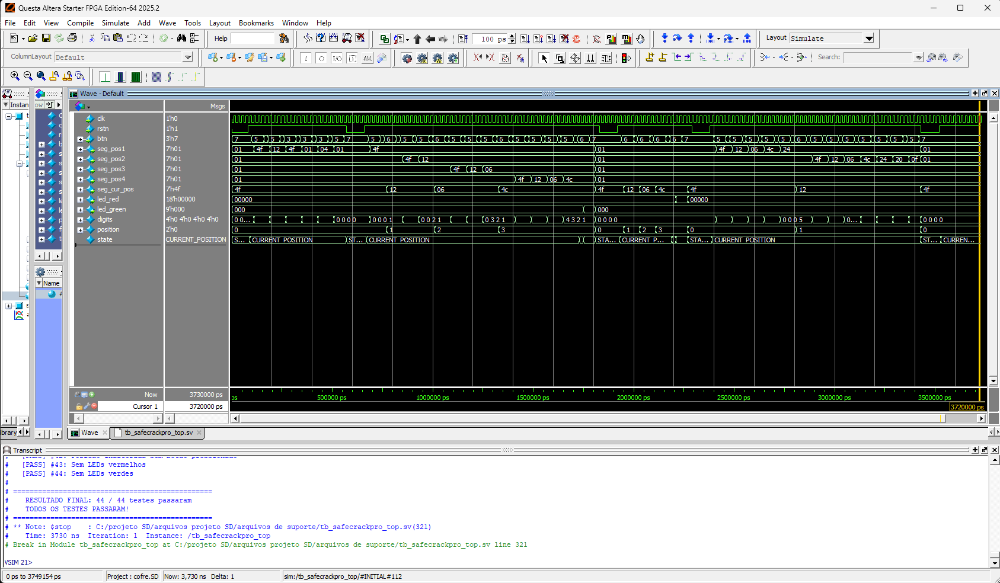

# Projeto_SD__cofre_DE2-115

## Diagrama de Estados

## Waveform Simulação

## Principais Bugs e Limitações
**Ausência de filtro de debounce mecânico nos botões (KEY[3:1]):** O código implementa um detector de borda síncrono (btn_pos & ~btn_prev) amostrado a 50 MHz (a cada 20 ns), mas não aplica um temporizador de filtragem (tipicamente 10 ms a 20 ms). Na simulação o sinal é ideal, mas na placa física o repique mecânico (bouncing) do botão pode fazer um único clique ser interpretado como dois ou mais pulsos seguidos, pulando números ou posições.

**Senha fixa no código-fonte (1-2-3-4):** Por compatibilidade com o testbench de validação, a senha está gravada como parâmetros fixos (localparam) no hardware, não permitindo que o usuário redefina uma nova senha diretamente pelos botões da placa.

**Tentativas ilimitadas sem bloqueio (lockout):** O sistema não contabiliza falhas consecutivas; após errar a senha e aguardar os 3 segundos de sinalização nos LEDs vermelhos, o usuário pode tentar novamente sem restrição.

**Bloqueio de entradas durante os temporizadores de feedback:** Durante os estados WAIT_GREEN_LED_TIME (5 s) e WAIT_RED_LED_TIME (3 s), os botões de edição e confirmação ficam inativos, sendo possível interromper a contagem apenas pelo reset global (KEY[0]).
